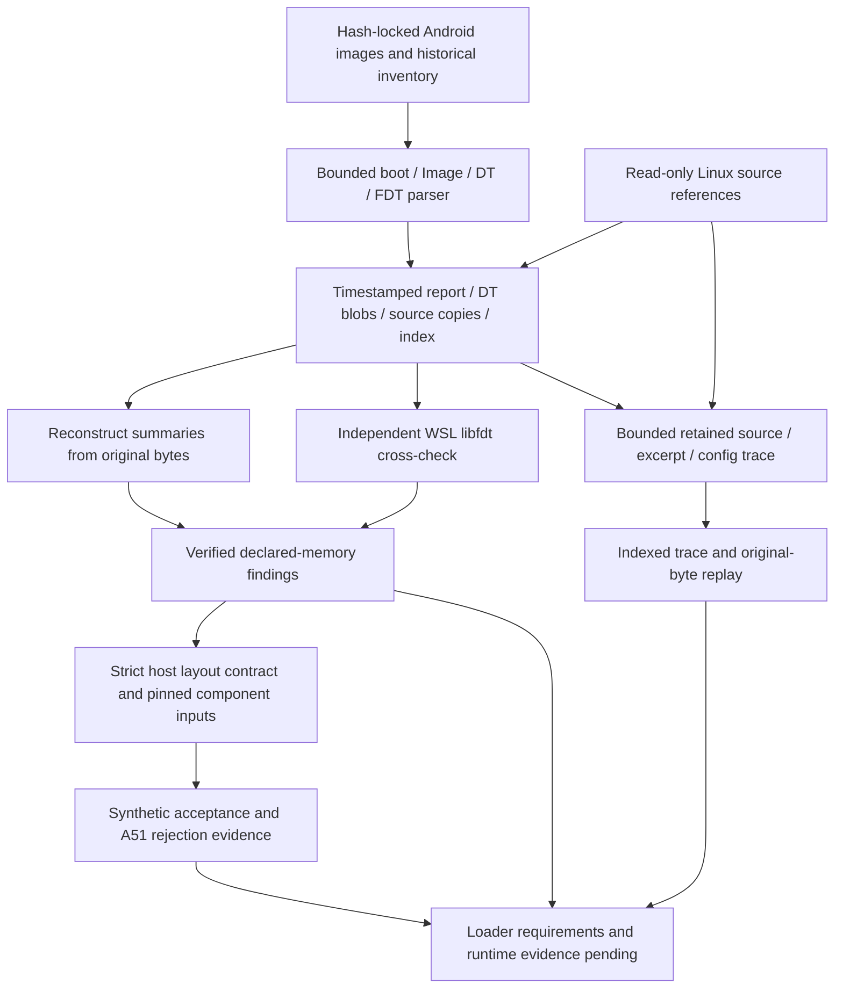
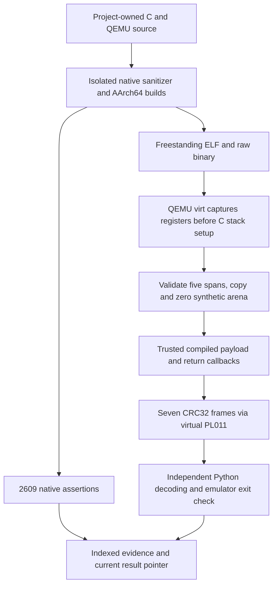

> Publication note: this is a historical workspace document. Current completion decisions are in [PUBLIC-STATUS.md](PUBLIC-STATUS.md); raw local evidence is described in [PUBLICATION.md](PUBLICATION.md).

# Architecture and responsibilities

The implementation has two targets: an upstream ARM64 QEMU baseline in Phase 1, and a future Exynos 9611 device port. Only observed execution logs can establish either target's runtime status. See STATE.md for the current result.

## Current build flow

```mermaid
flowchart TD
  A[Pinned HakiOS checkout] --> B[xnu/apply.sh]
  C[Apple XNU tag and HFS source] --> B
  B --> D[Generated xnu-src tree]
  E[Clang + Mach-O cctools + SDK headers] --> F[xnu-deps/setup.sh]
  D --> F
  F --> G[Header export + firehose + pthread libraries]
  D --> H[tools/make-kernel.sh]
  G --> H
  H --> I[hakios-kernel]
  A --> J[xnuloader/build.sh: loader.efi]
  A --> K[userland/src/hello.c: userland/hello]
  I --> L[xnuloader/mkpayload.py: payload.bin]
  K --> L
  J --> M[QEMU virt + AAVMF UEFI + TCG]
  L --> M
  M --> N[XNU + minimal process 1 serial output]
```

`scripts/build-open.sh` orchestrates this flow with `THEOS=/opt/a51-hakios/theos` and two compilation jobs. It creates the open `.config`, applies XNU source overlays, prepares dependencies, builds a kernel, placeholder EFI loader and raw-syscall hello executable, and packs a payload. An EXIT trap retains nested logs and provenance even when a step fails.

The placeholder loader identity avoids requiring an IPSW for this baseline. SDK headers and build tools are still required. “Open user program” means no proprietary iOS runtime is needed to execute hello; it does not mean all build dependencies are part of this repository.

## Source versus generated files

The pinned HakiOS repository is the source of build scripts, XNU patches, driver overlays, loader code and the minimal program. `xnu/apply.sh` fetches Apple's XNU tag and applies those overlays to `xnu-src/xnu-8796.121.2`. That generated tree deliberately differs from Apple's Git HEAD. Changes in it alone are fragile and can be lost when regenerated.

`drivers/` is synced into the generated tree by `xnu/sync-drivers.sh`. Configuration is translated by `tools/hakios-config.py`, including `config/MASTER.hakios` and `bsd/dev/hakios.drivers.h`. `xnu-deps/` contains tracked wrappers plus fetched sources, host binaries and a generated SDK overlay. The overlay adds public open-source substitutes for internal SDK components.

The default machine identifier is `BCM2837`, ARM64 DEVELOPMENT, with LTO disabled. This is an upstream build configuration; its name does not establish Raspberry Pi or A51 device support. QEMU runs `virt,gic-version=3`, Cortex-A76 and software CPU translation. The physical A51 has Cortex-A73/A53 and Exynos hardware, which QEMU does not emulate here.

## Runtime handoff

QEMU starts AAVMF UEFI, which finds `BOOTAA64.EFI`. The loader receives a packed kernel and RAM executable, constructs XNU's boot data, and enters the kernel. The upstream memory payload address is `0xF0000000`. The Phase 2 retained-image audit places that address inside the A51's declared modem reservation `[0xED000000, 0xF5A00000)`, so it must not be reused for an A51 payload. No safe alternative address is selected.

Hello uses raw Darwin system calls and no libc. Its serial output demonstrates execution of process 1. It exits after its checks; the ensuing process-1-exit panic is an expected end to this test when the preceding markers are present. A kernel panic before hello starts is a different result.

## Implemented Phase 2 host analysis

`boot_formats.py` handles binary bounds and declared tree semantics. `audit-boot-inputs.py` binds the four images to the immutable Phase 1 input inventory, extracts 11 FDTs across five DT tables, retains 13 references and verifies stored summaries against original bytes before publishing a current pointer. `check-boot-audit-libfdt.py` independently compares selected properties with `fdtget`/`fdtdump` and retains its commands and tool identities. These tools produce host evidence; they do not enter a payload or apply overlays.

The base trees declare three separate 2 GiB banks, 15 static reservation spans and three unplaced dynamic allocations. Runtime/secure/bootloader ownership is unknown. Revision 9 conditionally matches the EUR `_07` overlay, while actual selection and fixups remain unverified. Android header addresses lie outside declared RAM. All summaries retain `safe_for_loader_placement=false`; computed gaps subtract only known static spans. See [audit findings](PHASE-2-HOST-AUDIT.md) for exact ranges, provenance and semantic limits.

`payload_layout.py` imports the original-byte audit and checks strict schema/provenance, hashes/slices, unsigned 64-bit arithmetic, effective/padded extents, separate component roles, entry bounds and fixed/dynamic overlaps. `validate-payload-layout.py` retains exact manifests and indexed results, then reconstructs the outcomes before publishing a current pointer. All 92 guards passed on Windows and WSL; one synthetic case was accepted and all 21 A51 cases were rejected with required diagnostics. Both records replayed on both hosts. The [contract guide](PAYLOAD-LAYOUT.md) records selected paths/hashes and the three corrected replay failures.

Version 1 accepts observed synthetic assumptions only. It has no A51 runtime ownership importer, decompressor, XNU extent parser or physical copy/zero operation. Retained A51 banks remain source declarations, imported reservations cannot be removed by caller lists, and caller runtime labels cannot supply verified ownership. No executable A51 destination is selected; every result retains false device/placement/destination flags.

`source_trace.py` verifies the pinned boot audit and config/repack associations, collects complete read-only Linux files, numbers exact excerpt bytes, decodes selected FDT declarations and indexes retained inputs/tools/report. `trace-loader-sources.py` captures new timestamped evidence or reconstructs an existing trace against the retained specification and original sources/images/config/tools. Publication replaces the current pointer after verification; replay does not mutate evidence. The [source-trace guide](SOURCE-TRACE.md) records 28 sources, 40 excerpts, three base FDTs, 22 symbols, six tools and 82 indexed files, with 35 guards and successful original-byte replay per host. JSON/source/FDT/aggregate/file-count bounds apply before decoding or reconstruction.

This source root lacks Git metadata; the Android commit is recorded lineage, while per-file hashes pin inspected bytes. The trace identifies KASLR's loss of original saved x1–x3, conditional/possibly seed-modified FDT export, disabled debugfs ownership exports, legacy PSCI initialization, reset-resource prerequisites and conditional previous-buffer retrieval. These are source/configuration facts. All live-entry/FDT/ownership/log/return questions remain unresolved and every trace phone/device/placement flag is false.

## Future A51 flow

Phase 2 is `in_progress` with verified host analysis, host layout checks, retained-source tracing, [documented loader requirements](LOADER-DESIGN.md), a tested host/QEMU prototype, a temporary Android/Linux CPU-state diagnostic and a host-only early-entry candidate. It must still establish a Samsung-compatible entry path, measured payload extents, owned runtime layout, usable memory, actual firmware/pre-Linux CPU state, retrievable persistent fault logs and demonstrated return. The A51 adapter, runtime ownership importer and Samsung-packaged experimental image are not implemented, and the device gate is false. Phase 3 adds an Exynos platform to XNU. Later phases add display, input, UFS, power, GPU and radio/audio integration; Phases 3–10 remain planned.

KernelSU belongs to the existing Android Linux project. It neither loads XNU nor supplies a Darwin root manager. A temporary RAM boot on this A51 remains unproven; the retained Linux configuration disables kexec. `fastboot boot`, Qualcomm UEFI extraction and MediaTek repartition scripts are not established A51 procedures.

## Implemented privileged observation flow

`capture-live-loader.py` runs a fixed read-only ADB allowlist using the user's KernelSU Shell grant. A nonce-tagged shell footer separates remote command failure from transport success. Exact response/stdout/host-stderr bytes, tools, base FDTs and report are indexed; offline reconstruction rechecks status, timing, observations and current pinned inputs without phone access. The [live guide](LIVE-OBSERVATIONS.md) records 41 guards on Windows/native WSL, both replays and independent libfdt agreement.

The Linux-exported FDT, root and existing logs are observed; original firmware entry, owned memory and new-payload device log/return behavior remain unresolved. The host/QEMU probe is implemented separately below; its A51 physical launch remains unconfigured until those execution requirements are established.

## Implemented host/QEMU loader flow

The [prototype guide](LOADER-PROTOTYPE.md) defines this flow's interfaces and measured virtual entry. It uses QEMU direct-kernel loading, Cortex-A53, one CPU and 64 MiB RAM, separately from Phase 1's AAVMF/XNU/hello path. The payload bytes are data copied inside an arena; the prototype invokes trusted compiled code and does not branch to those bytes. The modeled stack span is zeroed test memory; QEMU's actual C stack is separate.

Fuel charges 16 input checks; finite BSS/log/return operations are uncharged. It is cooperative accounting, with host process timeouts providing a separate bound. CPU faults, device watchdogs, owned-memory import, cache/MMU/DMA/interrupt handoff, Samsung image and A51 entry/reset/log adapters remain planned. Callback return and QEMU PSCI SYSTEM_OFF prove only this virtual harness's behavior. Retained identities and exact command roles support replay/rebuild; they do not authenticate coherently replaced evidence or independently prove compiler derivation.

## Current offline observation and entry-contract milestone

The [offline runtime-observation map](RUNTIME-MAP.md) is implemented and verified: 80 guards passed on Windows/native WSL, and the selected historical Linux projection replayed against the complete original capture on both hosts. It records five DRAM declarations (6,327,107,584 bytes), 20 fixed reservation spans, 112 exclusion records, three unresolved dynamic placements and zero verified owned intervals; all 27 diagnostic candidates are rejected. The [entry-route source review](ENTRY-CONTRACT.md) retains 29 source/config files and 24 cited facts, explaining native Image extent, Linux kexec restrictions and the upstream EFI ABI. The A51 ownership-certification importer, adapter, physical transitions, new-payload logs and demonstrated return remain unresolved. No phone query/write/reboot/payload execution occurred in this host-only continuation.

Data flow: trusted schema-2 capture verifier and original dependencies -> historical DRAM/resource/reservation normalization -> bounded diagnostic rejection projection -> indexed packet/self-verification -> current pointer. The loader layout-v1 acceptance path is unchanged. Native Linux FDT entry and EFI system-table entry are different ABIs; the source-backed contract guide explains why the EFI application requires its actual services.

## Current CPU-state and early-entry milestones

The temporary Android [CPU-STATE.md](CPU-STATE.md) diagnostic executed eight `on_each_cpu()` callbacks on CPUs 0–7. Every callback observed EL1, `SCTLR_EL1=0x34d5d91d` with the MMU, data cache and instruction cache enabled, and a 26 MHz architectural counter; CPUs 0–3 identified as Cortex-A53 and CPUs 4–7 as Cortex-A73. This is Linux runtime callback state only. It is not Samsung firmware entry, pre-Linux or MMU-off state, standalone execution or a physical handoff.

The host-only [EARLY-ENTRY.md](EARLY-ENTRY.md) candidate passed five synthetic QEMU cases and 228 checks. A six-path isolated Android-source adaptation produced an 8,757-byte patch with SHA-256 `bb958f092d82f5b1d5b81761d5198d2a8bf0e80657ecc48a02d27b6e207f409f` and linked a 36,334,080-byte Linux `Image` with SHA-256 `87c0401361d4503afb0b266b15ff0caf1e64f505d61d53be700e8b6c6d8e9cf6`. The Image is not Samsung-packaged, flashed, booted or executed on the A51. Exception vectors, a device watchdog, persistent reset/fault logging, platform transitions and Android/recovery return remain unavailable; A51 execution, return and the Phase 2 device gate remain false.

## Host-only Samsung boot reconstruction boundary (P2-019)

The [SAMSUNG-BOOT-DRY-RUN.md](SAMSUNG-BOOT-DRY-RUN.md) path composes the retained Android v2 template, P2-018 kernel and prior repack record into an in-memory copy. Validation permits changes only to the kernel-size field, legacy boot ID, fixed kernel slot and AVB boot digest; ramdisk, DTB, footer/vbmeta positions and partition length remain fixed. The calculated candidate SHA-256 is `73d88c699dda238238b7b2b1105caea248b9ef3aef282a3f01b566f0fd894a58`.

This adds a host packaging-validation layer after isolated kernel linkage; it does not add a device loader layer. The implementation discards the candidate reference and retains only bounded JSON/source evidence. Samsung firmware acceptance, physical entry, owned-memory import, exception/watchdog control, platform transitions, persistent logging and return remain downstream architecture gaps, and every device gate remains false.
