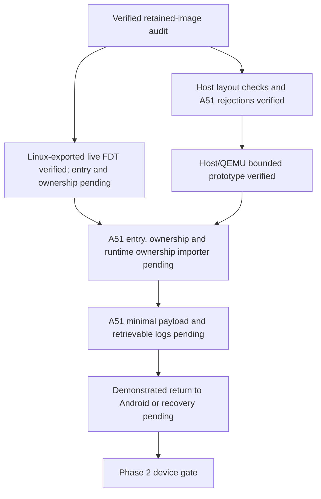

> Publication note: this is a historical workspace document. Current completion decisions are in [PUBLIC-STATUS.md](PUBLIC-STATUS.md); raw local evidence is described in [PUBLICATION.md](PUBLICATION.md).

# A51 loader design requirements after the retained-image audit

Date: 11 November 2026. Status: documented A51 requirements, verified host layout checks, retained-source trace, privileged read-only live observations and an executable host/QEMU loader prototype. The A51 adapter, experimental Samsung image and device execution are not implemented.

The [host audit](PHASE-2-HOST-AUDIT.md) supplies image identities, declared RAM/reservations and a conditional overlay candidate. The [implemented payload-layout validator](PAYLOAD-LAYOUT.md) checks synthetic assumptions and rejects unsupported A51 layouts. The [retained-source trace](SOURCE-TRACE.md) binds entry/FDT/memory/log/reset code and configuration to inspected bytes. These host results leave the execution route, usable-RAM ownership and demonstrated reset/return unresolved. Phase 2 remains in progress until its device gate is demonstrated.

## Evidence required before device execution

| Requirement | Current evidence | Missing evidence or work |
|---|---|---|
| Actual entry route and PC | Android v2 and Linux Image headers; retained `head.S`/ARM64 boot protocol | Samsung relocation/entry behavior and acceptance of the chosen route |
| CPU and platform state | Linux protocol describes x0 FDT and entry requirements; retained KASLR code saves x0 but zeros saved x1–x3 | Measured CurrentEL, PC/SP, original register state, timer frequency, cache/MMU, secondary CPUs and DMA state |
| Exact DT | Retained bases plus verified unchanged Linux-exported live FDT: 224,774 bytes, 1,087 nodes, A51 EUR REV02 model; independent libfdt agreement | Original pre-Linux fixups, exact overlay selection, original register state and fitted peripheral identities |
| Usable memory | Retained bases plus live split RAM declarations, real iomem kernel addresses and MemTotal; dynamic reg/debugfs reads unavailable, live DEBUG_FS disabled | Secure/bootloader/kernel/FDT/initrd/page-table/DMA ownership and verified available intervals; account for product-ship redaction and limited records |
| Payload format and extent | Existing QEMU identities, Android image bounds and verified host hash/slice/full-extent checks | Samsung-compatible wrapper, XNU entry ABI, measured execution/BSS/stack/FDT/log extents and a runtime-ownership importer |
| Retrievable logs | Existing Android console-ramoops and filtered previous last_kmsg retrieved; traced buffer modes/copying and conditional pstore persistence | A tested output path and an owned buffer whose contents can be recovered after this bounded run/reset |
| Return | Traced Linux restart selection, Samsung/Exynos callbacks and watchdog prerequisites; legacy PSCI binding does not register standard SYSTEM_RESET in the inspected path | Actual firmware capabilities, active initialization/handler and a demonstrated return for this exact probe with retained logs |

These prerequisites apply to device execution. Host implementation of a bounded probe can begin with simulated inputs while physical addresses and launch remain unconfigured. This continuation implemented host tools and read-only Android observations. It contains no executable flashing, repartitioning or loader-installation step.

## Candidate routes and current limits

Linux-to-payload handoff remains a research candidate. The retained installed configuration disables kexec, and ordinary ADB had no usable `su` entry point in the historical capture; Shell root is now verified after the user's KernelSU grant. Enabling kexec would change the Android project and still require memory ownership, quiescing, CPU/cache transitions and a payload ABI. No such change or successful no-flash route is implemented here.

A Samsung-compatible experimental boot-image route is also a future design candidate. The headers' low addresses are outside declared DRAM, so neither a literal header address nor a generic Linux placement formula identifies Samsung's real behavior. Full image trailing data, signatures/vendor conventions, load limits and a return arrangement require separate evidence. No experimental image was repacked, signed, installed or executed.

The existing EFI application depends on QEMU/AAVMF services. MediaTek/Qualcomm loader or repartition instructions do not establish an Exynos route. KernelSU Linux and the HakiOS Mach-O kernel have different entry/runtime requirements.

## Implemented host layout contract and remaining runtime evidence

Version 1 is implemented in `scripts/payload_layout.py` and `validate-payload-layout.py`. Its [contract and evidence guide](PAYLOAD-LAYOUT.md) defines image hashes/slices, execution/reservation extents, entry metadata and memory intervals with observed, conditional or unknown provenance. Acceptance is limited to observed synthetic assumptions on `synthetic-host`. The `a51-retained-host` target imports verified historical declarations and always rejects an executable layout; no A51 runtime ownership importer exists. Caller runtime labels cannot promote declared RAM to verified ownership.

The validator checks unsigned 64-bit bounds, positive sizes, overflow, alignment, containment within one supported interval and pairwise overlap. It models loader, full effective kernel extent, payload/program/root image, FDT, BSS, stack, page tables, scratch and logs separately. Reservations include prefixes, suffixes and alignment padding. Synthetic expanded extents are checked as assertions; no decompressor or XNU execution-extent parser is implemented. These host scripts do not copy or zero physical memory. A valid file checksum cannot establish memory ownership.

Imported static reservations are immutable exclusions. The modem range includes `0xF0000000`, so the QEMU destination is prohibited in an A51 layout. Dynamic ION/WLBT reservations have sizes/alignment but no actual location; allocation ranges are constraints. Existing secure/debug/firmware/modem memory and unexplained gaps cannot become scratch space because they have a convenient address. Rejected diagnostic manifests are retained; no executable A51 destination or runtime layout is selected.

All 92 guards passed on Windows and WSL. One synthetic demonstration was accepted; 21 A51 cases were rejected with the required diagnostics, covering unplaced inputs, the modem conflict, every fixed reservation, both high banks, static-gap ownership and attempted runtime-label promotion. Both records replayed on both hosts. The tests also cover boundary/overflow, truncation, hash drift, effective extents, dynamic ownership and entry/log/return prerequisites. This establishes host behavior; `safe_for_loader_placement` and the Phase 2 device gate remain false.

## Implemented host/QEMU probe and pending A51 logs

The [loader prototype guide](LOADER-PROTOTYPE.md) describes the implemented freestanding core and QEMU adapter in `prototype/loader/`. Native ASan/UBSan tests passed 2,609 assertions; the AArch64 ELF linked without undefined symbols and executed a tiny compiled payload in QEMU. Seven 256-byte little-endian CRC32 frames cover entry, validation, preparation, payload entry/exit and return request/result. Assembly captures virtual entry registers before selecting the C stack. The independent host decoder verifies all frames and emulator exit 0.

This core validates five disjoint spans in a synthetic arena before copying/zeroing bytes. Copied input is test data; trusted callbacks provide payload and return code. Fuel is cooperative accounting and cannot preempt a hang. Separate 30-second native/20-second QEMU process timeouts bound these host executions. CPU fault vectors, a device watchdog, runtime ownership importer, physical state transitions and Samsung entry/reset/log adapters remain planned. QEMU's ordinary callback return and PSCI shutdown prove no Android/recovery return.

The source trace passed 35 guards per host and original-byte replay on Windows/WSL. Its 28 files/40 excerpts, three base FDTs and 22 symbols are pinned in 82 indexed files. Linux commit `468ab8343364e4d3a267e670fa6a22fd4197a805` is recorded lineage from repack metadata; the inspected root has no Git metadata. Do not treat these byte-pinned source findings as a verified remote checkout or runtime measurements.

The first device milestone is a minimal loader payload, before XNU integration. Begin with a single CPU and an identified owned memory budget. Capture entry state before altering it; state-changing operations need the measured exception level and platform-specific quiescing/cache/interrupt/reset design. A generic Linux `head.S` expectation is not a measured Samsung or XNU contract.

The host/QEMU record format includes magic/version, build/input/FDT identities, sequence/stage, entry registers, fuel, callback outcome and CRC32. Its FDT identity is zero because this adapter does not consume the tree. General caller identity fields are assertions; the retained build and independent decoder bind this demonstration's bytes. Future A51 records need fault information, actual device entry/DT provenance and demonstrated persistence/retrieval in addition to this host format.

RAM logging requires an owned buffer and demonstrated retrieval/persistence. Source addresses for debug-snapshot, seclog or modem logging do not authorize reusing their storage or prove accessibility from a new payload. UART, framebuffer and existing log buffers are candidates to investigate, not available consoles. Retrievable evidence must survive the chosen return/reset procedure.

Define a bounded test duration, fault path and reset mechanism before running a probe. A simple C/assembly return is not sufficient after replacing page tables, vectors, cache state or device ownership. PSCI/reset/watchdog availability and exact behavior are unknown; no register address or reset call is proposed as established here. Retained backups document inputs, while successful restoration/return must be observed for the actual probe.

## Milestones and acceptance

The roadmap's Phase 2 pass gate requires loader execution on the A51, a minimal payload, retrievable logs and demonstrated return to Android/recovery. Compilation, host parsing, a matching overlay interval or a connected phone cannot pass it. Phase 3 then requires its own repeated XNU/user-program device runs.

Next work: resolve actual Samsung entry, owned memory, platform transitions and payload log/return behavior before configuring an A51 adapter. Use the [verified live observations](LIVE-OBSERVATIONS.md), retained source trace and tested host interfaces. The selected live FDT and root capture are complete; do not repeat them as an unresolved prerequisite. New runtime evidence needs a separately implemented importer and validation before a device probe can rely on it. Project-owned prototype source is separate from upstream; future XNU port work needs a separate experimental checkout. Preserve `/opt/a51-hakios`'s accepted upstream baseline and both existing Android projects. Phase 1 completion evidence remains unchanged.

Revisit this design after each new observation and record changes in IMPLEMENTATION-LOG.md. Rollback of this document or the host audit requires no phone action. Any future port source/configuration/payload change needs its own provenance, tests, failures and rollback record.

## Current offline observation and entry-contract milestone

The [offline runtime-observation map](RUNTIME-MAP.md) is implemented and verified: 80 guards passed on Windows/native WSL, and the selected historical Linux projection replayed against the complete original capture on both hosts. It records five DRAM declarations (6,327,107,584 bytes), 20 fixed reservation spans, 112 exclusion records, three unresolved dynamic placements and zero verified owned intervals; all 27 diagnostic candidates are rejected. The [entry-route source review](ENTRY-CONTRACT.md) retains 29 source/config files and 24 cited facts, explaining native Image extent, Linux kexec restrictions and the upstream EFI ABI. The A51 ownership-certification importer, adapter, physical transitions, new-payload logs and demonstrated return remain unresolved. No phone query/write/reboot/payload execution occurred in this host-only continuation.
